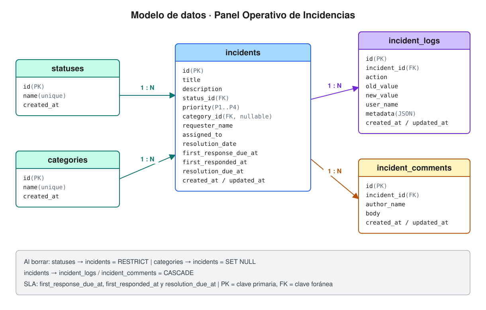

# Panel Operativo de Incidencias

Aplicación web pequeña para gestionar incidencias en un tablero Kanban, con trazabilidad completa de cambios, modelo de SLA en horario de oficina y una herramienta de diagnóstico y saneamiento de datos.

**Stack:** PHP 8.4 · Laravel 13 · MySQL 8 · Blade + Livewire 4 · Tailwind CSS 4 · JavaScript (Alpine, incluido en Livewire, y SortableJS).

## Requisitos

| Herramienta | Versión | Notas |
|---|---|---|
| PHP | 8.3 o superior (desarrollado con 8.4) | Extensiones: `pdo_mysql`, `mbstring`, `openssl`, `curl`, `fileinfo`, `intl`, `zip`. Activa **OPcache** (ver [Rendimiento](#rendimiento)) |
| Composer | 2.x | |
| Node.js | 20 o superior (desarrollado con 24) | Con npm |
| MySQL | 8.0 o superior (desarrollado con 8.4) | |

## Instalación

```bash
git clone https://github.com/carlos349/panel-operativo-incidencias.git panel-incidencias
cd panel-incidencias

composer install
npm install

cp .env.example .env
php artisan key:generate
```

Crea la base de datos y ajusta las credenciales en `.env` (`DB_HOST`, `DB_PORT`, `DB_DATABASE`, `DB_USERNAME`, `DB_PASSWORD`):

```sql
CREATE DATABASE incidents_panel CHARACTER SET utf8mb4 COLLATE utf8mb4_unicode_ci;
```

`APP_TIMEZONE` (por defecto `Europe/Madrid`) define la zona horaria del horario de oficina que usa el SLA.

## Migraciones y datos de ejemplo

```bash
php artisan migrate:fresh --seed
```

Ese comando ejecuta tres seeders:

| Seeder | Contenido |
|---|---|
| `CatalogSeeder` | Estados (`Abierta`, `En Revisión`, `Bloqueada`, `Resuelta`, `Anulada`) y categorías (`Seguridad`, `Redes`, `Accesos`, `Bug Informático`) |
| `IncidentSeeder` | 11 incidencias coherentes, creadas a través del servicio de dominio, con su historial y sus plazos de SLA reales |
| `CorruptDataSeeder` | 6 incidencias **inconsistentes a propósito** (ver [Caso práctico](#caso-práctico-diagnóstico-y-saneamiento)) |

Para cargar solo los datos inconsistentes sobre una base ya migrada:

```bash
php artisan db:seed --class=CorruptDataSeeder
```

## Levantar el proyecto

```bash
npm run build
php artisan serve
```

La aplicación queda en <http://localhost:8000>. Durante el desarrollo, `npm run dev` en otra terminal sustituye a `npm run build` y recarga los cambios de frontend.

**Usuario de prueba:** no hay autenticación (fuera de alcance). El campo **«Actuando como»** de la cabecera fija el nombre que firma logs y comentarios; por defecto es `Operador Demo` y se guarda en la sesión.

Tests (SQLite en memoria, no tocan MySQL):

```bash
php artisan test
```

## Rendimiento

Con **OPcache desactivado**, PHP recompila todo Laravel en cada petición. En el entorno de desarrollo (Windows, `php artisan serve`) eso suponía unos 0,6 s por petición; con OPcache activo bajó a unos 0,1 s. En `php.ini`:

```ini
zend_extension=opcache
opcache.enable=1
opcache.enable_cli=1
```

`opcache.enable_cli=1` es necesario porque `php artisan serve` usa el servidor embebido de PHP, que corre como CLI. En producción conviene además `php artisan optimize` (caché de configuración, rutas y vistas).

## Modelo de datos



El diagrama es editable: abre [`docs/modelo-de-datos.excalidraw`](docs/modelo-de-datos.excalidraw) en [excalidraw.com](https://excalidraw.com) (menú → *Abrir*).

Las tablas siguen la especificación. Decisiones añadidas:

- `incidents.priority` guarda el código corto (`P1`…`P4`). La etiqueta visible (`P1 Critical`, `P2 Alta`…) vive en el enum `App\Enums\Priority`, así la UI no depende del valor almacenado.
- `incidents` añade tres columnas para el SLA: `first_response_due_at`, `first_responded_at` y `resolution_due_at`.
- Claves foráneas: borrar un estado en uso está prohibido (`RESTRICT`), borrar una categoría deja la incidencia sin categoría (`SET NULL`) y borrar una incidencia arrastra sus logs y comentarios (`CASCADE`).
- Índices: `incidents(status_id, priority)` para el tablero, `incidents(resolution_due_at)` e `incident_logs(incident_id, created_at)` para el historial.
- `statuses.name` es el catálogo; las reglas (transiciones, confirmaciones) están en `App\Enums\IncidentStatus`, cuyo valor coincide con el nombre.

## Modelo de SLA

Los plazos se miden en **tiempo laboral**: lunes a viernes de 08:00 a 17:00 (jornada de 9 h). Fuera de ese horario el reloj no avanza.

| Prioridad | Primera respuesta | Resolución |
|---|---|---|
| P1 Critical | 15 min | 4 h |
| P2 Alta | 1 h | 9 h (1 día laboral) |
| P3 Media | 4 h | 27 h (3 días laborales) |
| P4 Baja | 9 h (1 día laboral) | 45 h (5 días laborales) |

Ejemplo: una P1 creada un viernes a las 16:30 vence el lunes a las 11:30 (30 min el viernes + 3 h 30 min el lunes).

- **Configuración:** `config/sla.php` (horario, festivos, matriz en minutos y umbral de riesgo).
- **Cálculo:** `App\Support\Sla\BusinessHoursCalculator` hace la aritmética de tiempo laboral; `App\Support\Sla\SlaPolicy` traduce prioridad a fechas límite y evalúa el estado.
- **Estados de SLA:** en plazo, en riesgo (queda el 25 % o menos del plazo), vencido; al resolver, cumplido o incumplido.
- **Primera respuesta:** se registra con el primer comentario o al salir de `Abierta`, lo que ocurra antes.
- **Bloqueada no pausa el reloj.** Pausarlo es más fiel a ITIL, pero exige contabilizar tramos de pausa; se priorizó un modelo simple y que una incidencia bloqueada siga siendo visible como riesgo.
- **Reapertura:** limpia `resolution_date` y recalcula el plazo de resolución desde ese momento.
- Los plazos se calculan al crear la incidencia. La prioridad no es editable desde la UI, así que no hay recálculo por cambio de prioridad.

## Reglas de negocio

Flujo de estados:

| Desde | Puede pasar a |
|---|---|
| `Abierta` | `En Revisión`, `Anulada` |
| `En Revisión` | `Bloqueada`, `Resuelta`, `Anulada` |
| `Bloqueada` | `En Revisión` (desbloqueo), `Anulada` |
| `Resuelta` | `Abierta` (reapertura, motivo obligatorio) |
| `Anulada` | — (estado final) |

- **Estado inicial:** una incidencia sin responsable solo puede crearse `Abierta`; con responsable puede crearse `Abierta` o `En Revisión`. El formulario solo ofrece las opciones válidas y el servicio rechaza cualquier otra.
- **Anulación:** cualquier incidencia no resuelta puede anularse. Exige confirmación y motivo, es definitiva y deja la incidencia fuera del SLA (ni cumple ni incumple).

- **Transacciones:** `App\Services\IncidentService` es el único punto de escritura. Cada operación (crear, editar, cambiar estado, comentar) modifica la incidencia e inserta su log dentro del mismo `DB::transaction`, con bloqueo de fila (`lockForUpdate`) para evitar escrituras concurrentes sobre datos obsoletos.
- **Reapertura:** `Resuelta → Abierta` genera un log con acción `reopened` y el motivo en `metadata`. Sin motivo, el servicio rechaza la operación.
- **Confirmaciones:** pasar a `Bloqueada`, `Resuelta` o `Anulada` (y reabrir) abre un diálogo de confirmación. La regla se valida también en servidor: la UI no puede saltársela.
- Las transiciones no permitidas se rechazan con un aviso y no dejan rastro en la base de datos.

## Interfaz

- **Contadores por estado** que actúan como filtro, y filtros por estado, prioridad y texto libre (reflejados en la URL).
- **Tablero** con tarjetas que resaltan las incidencias con SLA vencido (rojo, indicador animado) y las bloqueadas (candado).
- **Cambio de estado:** arrastrar y soltar en escritorio; desplegable en la tarjeta en móvil y pantallas táctiles.
- **Vista detallada** en panel lateral: edición de título y descripción, cambio de estado y pestañas de comentarios e historial.

### Temas

El selector **Tema** de la cabecera cambia la paleta al instante y recuerda la elección en el navegador (`localStorage`).

| Tema | Carácter | Fondo | Superficie | Texto | Acento |
|---|---|---|---|---|---|
| Claro (por defecto) | Neutro frío | `#E9EEF5` | `#FFFFFF` | `#0F172A` | Índigo `#4F46E5` |
| Océano | Claro azulado | `#E1EDF3` | `#FFFFFF` | `#0B2B3C` | Petróleo `#0E7490` |
| Tierra | Claro cálido | `#EFE7DA` | `#FFFDF9` | `#2A211A` | Ámbar tostado `#B45309` |
| Consola | Oscuro pizarra | `#070C16` | `#18233A` | `#F8FAFC` | Verde operativo `#22C55E` |
| Alto contraste | Negro puro | `#000000` | `#000000` | `#FFFFFF` | Amarillo `#FFD600` |

- Los componentes solo usan **colores semánticos** (`bg-surface`, `text-ink`, `bg-danger-soft`…). Cada tema da valor a las mismas variables CSS en `resources/css/themes.css`, y `resources/css/app.css` las expone a Tailwind.
- Los significados no cambian entre temas: azul = abierta, ámbar = en revisión, rojo = bloqueada o vencida, verde = resuelta, gris = anulada.
- Añadir un tema son dos pasos: un bloque `[data-theme='…']` en `themes.css` y una entrada en `config/themes.php`.
- Los desplegables (`<select>`) siguen el tema también en su panel de opciones: se usa `appearance: base-select` donde el navegador lo admite y, donde no, las opciones heredan los colores del tema.

## Decisiones de arquitectura frontend:

- **Composición:** `x-ui.modal` define el contenedor y recibe título, cuerpo y pie por slots; `x-ui.field` envuelve cualquier control con su etiqueta y error.
- **Componentes polimórficos:** `x-ui.button` (`as="button|a"`), `x-ui.badge` (`as="span|button|a"`) y `x-ui.control` (`as="input|select|textarea"`) cambian de etiqueta HTML conservando estilo y API.
- **Desacoplamiento:** las vistas no reciben modelos Eloquent. `App\ViewModels\IncidentCard` y `App\ViewModels\TimelineEntry` entregan datos ya traducidos a presentación (etiquetas, «tonos» semánticos, textos de SLA). Los colores se resuelven solo dentro de los componentes Blade.
- **Tres componentes Livewire** comunicados por eventos: `IncidentBoard` (tablero, filtros y confirmaciones), `CreateIncident` (alta) e `IncidentDetail` (detalle).
- En el arrastre, el DOM no decide: al soltar, la tarjeta vuelve a su sitio y se pide el cambio al servidor, que valida y repinta.

### ¿Por qué Blade + Livewire en lugar de Inertia + React?
Para un panel operativo pequeño, **Blade + Livewire** permite construir una interfaz reactiva sin salir de Laravel. Toda la lógica (validación, reglas del flujo de estados, transacciones y cálculo de SLA) vive en un único lugar —el servidor— y la interfaz se limita a reflejarla. Con **Inertia + React**, esa misma lógica obliga a mantener dos capas sincronizadas: controladores y *props* en PHP por un lado, y estado, tipado y componentes en JavaScript por otro.

## Caso práctico: diagnóstico y saneamiento

### Datos inconsistentes sembrados

`CorruptDataSeeder` inserta con el query builder, saltándose `IncidentService`, para simular scripts manuales o importaciones defectuosas. Los títulos empiezan por `[Inconsistente …]`.

| Caso | Inconsistencia | Tratamiento |
|---|---|---|
| 1A | `Resuelta` sin log de resolución, con `resolution_date` | Autocorrección |
| 1B | `Resuelta` sin log de resolución y sin `resolution_date` | Revisión manual |
| 2A | Estado `En Revisión`, último log dice `Abierta` | Autocorrección |
| 2B | Estado `Bloqueada`, último log dice `Resuelta` | Revisión manual |
| 3A | Log de cambio de estado duplicado | Autocorrección |
| 3B | Log fechado antes de que existiera la incidencia | Revisión manual |

### Comandos

Ver qué se haría, sin modificar nada:

```bash
php artisan incidents:repair --dry-run
```

Aplicar las correcciones:

```bash
php artisan incidents:repair
```

El comando es idempotente: una segunda ejecución no vuelve a corregir ni a marcar lo ya tratado (los casos pendientes aparecen como «Ya marcada»). La lógica está en `App\Services\Integrity\IncidentIntegrityService`; cada hallazgo se aplica en su propia transacción con la incidencia bloqueada.

### Consultas de detección

«Log de estado» significa un log con `action IN ('created', 'status_changed', 'reopened')`, cuyo `new_value` es un estado.

**1. Resueltas sin log de resolución**

```sql
SELECT i.id, i.resolution_date
FROM incidents i
JOIN statuses s ON s.id = i.status_id
WHERE s.name = 'Resuelta'
  AND NOT EXISTS (
      SELECT 1 FROM incident_logs l
      WHERE l.incident_id = i.id
        AND l.action IN ('created', 'status_changed', 'reopened')
        AND l.new_value = 'Resuelta'
  );
```

**2. Estado actual distinto del `new_value` del último log de estado**

```sql
SELECT i.id, s.name AS current_status, l.new_value AS logged_status
FROM incidents i
JOIN statuses s ON s.id = i.status_id
JOIN incident_logs l ON l.id = (
    SELECT l2.id FROM incident_logs l2
    WHERE l2.incident_id = i.id
      AND l2.action IN ('created', 'status_changed', 'reopened')
    ORDER BY l2.created_at DESC, l2.id DESC
    LIMIT 1
)
WHERE l.new_value <> s.name;
```

La subconsulta correlacionada elige el último log de estado de cada incidencia; el desempate por `id` cubre logs con la misma fecha. Las `Resuelta` sin log de resolución se excluyen aquí porque ya las trata el caso 1.

**3a. Logs duplicados**

```sql
SELECT incident_id, action, user_name, created_at, MIN(id) AS keep_id, COUNT(*) AS copies
FROM incident_logs
GROUP BY incident_id, action, old_value, new_value, user_name, created_at
HAVING COUNT(*) > 1;
```

**3b. Logs anteriores a la creación de su incidencia**

```sql
SELECT l.id, l.incident_id, l.created_at, i.created_at AS incident_created_at
FROM incident_logs l
JOIN incidents i ON i.id = l.incident_id
WHERE l.created_at < i.created_at;
```

### Decisiones: qué se corrige y qué no

Criterio: **solo se autocorrige cuando los propios datos aportan evidencia suficiente para reconstruir lo ocurrido.** Si hay que inventar información (quién, cuándo o por qué), la incidencia se marca para revisión manual y no se toca nada más.

**Se corrigen automáticamente**

- **1A.** El estado `Resuelta` y `resolution_date` coinciden: dos datos independientes dicen lo mismo. Se crea el log que falta, fechado en `resolution_date`.
- **2A.** El salto entre el último log y el estado actual es exactamente un paso válido del flujo. La explicación más simple es un cambio que no dejó log. Se crea el log, fechado en `updated_at`.
- **3A.** Las copias son idénticas en todos sus campos, así que eliminar las sobrantes no pierde información. Aun así, se conserva una copia de lo eliminado en `metadata` de un log `data_repair`.

Los logs reconstruidos se firman como `sistema:saneamiento` y llevan `metadata.inferred = true`: nunca se hacen pasar por una acción humana.

**Se marcan para revisión manual**

- **1B.** Sin `resolution_date` no hay evidencia de cuándo se resolvió ni de si realmente se resolvió. Crear el log sería fabricar un hecho.
- **2B.** `Resuelta → Bloqueada` no es una transición del flujo. Puede estar mal el estado o puede estar mal el log; elegir uno automáticamente tiene un 50 % de probabilidad de destruir el dato correcto.
- **Reaperturas y anulaciones implícitas** (el estado actual es `Abierta` tras `Resuelta`, o `Anulada`, sin log que lo explique): la regla de negocio exige un motivo explícito, que no se puede inventar.
- **3B.** No se sabe si la fecha es errónea o si el log pertenece a otra incidencia. Borrarlo o refecharlo destruiría la evidencia que un humano necesita para decidir.

Marcar para revisión significa insertar un log `manual_review` con el problema y la razón por la que no se autocorrige. Queda visible en la pestaña **Historial** de la incidencia.

## Estructura del código

```
app/
├── Console/Commands/RepairIncidents.php   Comando incidents:repair
├── Enums/                                  Priority, IncidentStatus, LogAction, SlaState
├── Livewire/                               IncidentBoard, CreateIncident, IncidentDetail
├── Services/IncidentService.php            Escrituras transaccionales + logs
├── Services/Integrity/                     Diagnóstico y saneamiento
├── Support/Sla/                            Calendario laboral y política de SLA
└── ViewModels/                             Datos de presentación para las vistas
config/sla.php                              Matriz y horario de SLA
config/themes.php                           Catálogo de temas
resources/css/themes.css                   Paletas de cada tema
resources/views/components/ui/              Componentes Blade reutilizables
resources/views/components/incident/        Tarjeta del tablero
resources/views/livewire/                   Vistas de los componentes Livewire
```

## Fuera de alcance

Según la especificación: autenticación y roles, notificaciones, suites de tests extensas, Docker, despliegue e integraciones externas. Se incluyen 15 tests que cubren el calendario laboral y las reglas del flujo de estados.

Limitaciones conocidas:

- Los festivos se configuran a mano en `config/sla.php`; no hay calendario por país.
- El tablero carga todas las incidencias que cumplen los filtros, sin paginación. Es adecuado para el volumen de un panel operativo, no para un histórico de miles de registros.
- La prioridad, la categoría, el solicitante y el responsable se fijan al crear la incidencia y no son editables desde la UI.
